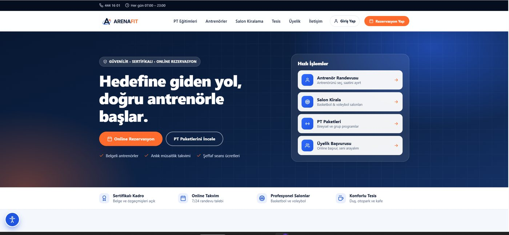
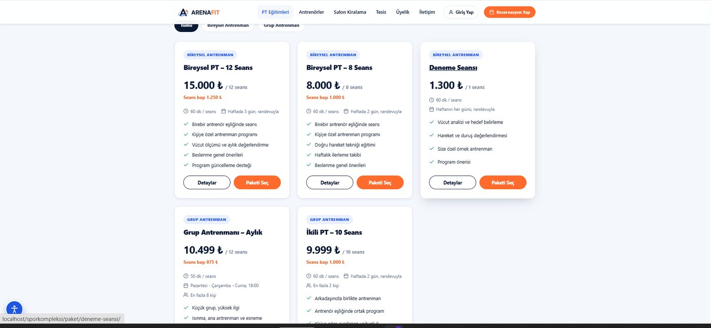
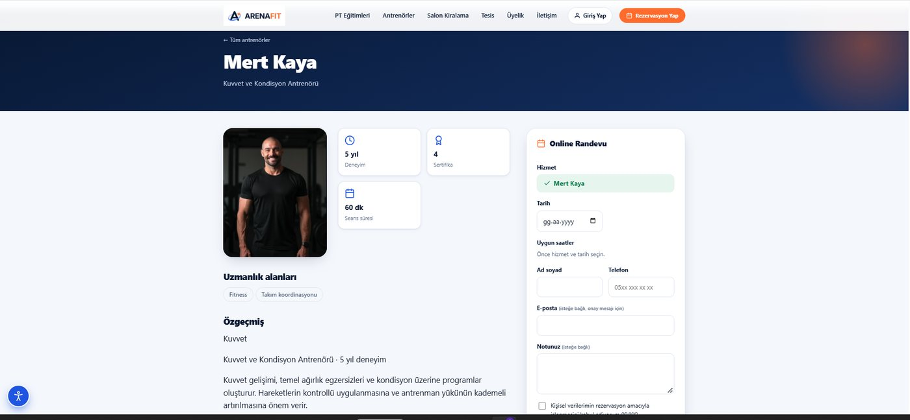
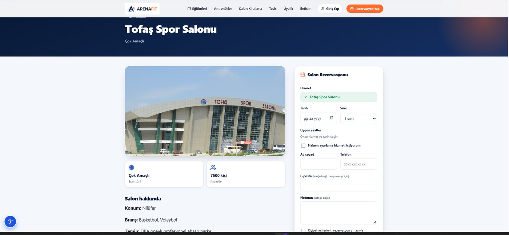
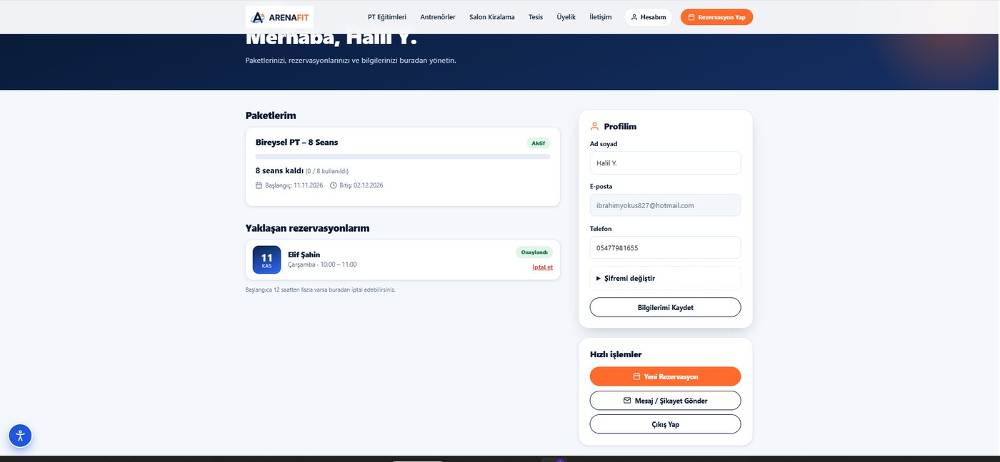
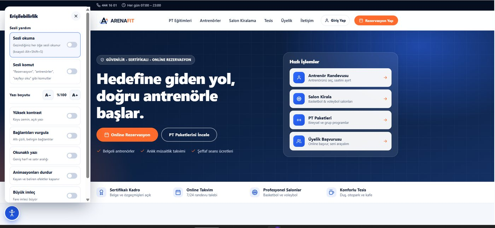
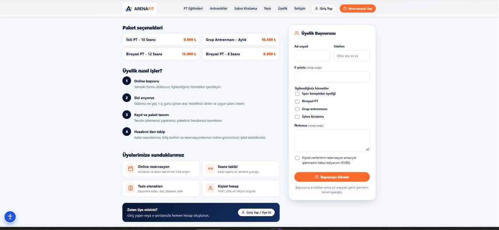

# ArenaFit – Spor Kompleksi WordPress Teması

Bursa'daki bir spor kompleksi için hazırlanmış WordPress teması. Ziyaretçiler PT paketlerini ve antrenörleri inceleyip online randevu alır, basketbol ve voleybol salonu kiralar, üyelik başvurusu yapar. Yönetici tüm kayıtları WordPress panelinden yönetir. Ek eklenti gerekmez.



## Özellikler

- **PT eğitimleri:** Bireysel ve grup paketleri, seans ücretleri tablosu, paket detay sayfası (kapsam, eğitim günleri, program akışı, seviye)
- **Antrenörler:** Profil, uzmanlık alanı süzgeci ve arama, özgeçmiş, eğitim, sertifikalar, belge görselleri, 14 günlük online takvim
- **Online rezervasyon:** Antrenör ve salon için boş saat seçimi, çakışma kontrolü, onay e-postası, yönetici onayı
- **Salon kiralama:** Basketbol ve voleybol salonları, foto galerisi, hakem hizmeti, doluluk takvimi
- **Tesis olanakları:** Soyunma odası, duş, otopark, kafe (fotoğraf ve açıklamalar Özelleştir'den)
- **Üyelik:** Online başvuru, üye hesabı, paket ve kalan seans takibi, rezervasyon iptali
- **İletişim:** Mesaj / şikayet formu, kayıt numarası, harita
- **Erişilebilirlik:** Yazı boyutu, yüksek kontrast, bağlantı vurgusu, okunaklı yazı, animasyon durdurma, büyük imleç, **Türkçe sesli okuma** ve **sesli komut**

## Gereksinimler

- WordPress 6.3 veya üstü (Türkçe önerilir)
- PHP 7.4 veya üstü (8.2 ile test edildi)
- Yerelde denemek için [XAMPP](https://www.apachefriends.org/tr/index.html)

## Kurulum

1. **WordPress'i kurun.** Örneğin XAMPP ile: WordPress'i `C:\xampp\htdocs\` altına çıkarın, phpMyAdmin'de boş bir veritabanı açın ve WordPress kurulum sihirbazını tamamlayın.
2. **Temayı ekleyin.** Bu depodaki `arenafit` klasörünü WordPress'in `wp-content/themes/` klasörüne kopyalayın. Panelden yüklemek isterseniz `arenafit` klasörünü zipleyip **Görünüm > Temalar > Yeni Ekle > Tema Yükle** ile yükleyin.
3. **Temayı etkinleştirin.** **Görünüm > Temalar > ArenaFit > Etkinleştir.** Rezervasyon, Üyelik, Tesis Olanakları, Hesabım, İletişim ve Erişilebilirlik sayfaları ile ana menü kendiliğinden oluşur.
4. **Kalıcı bağlantıları açın.** **Ayarlar > Kalıcı Bağlantılar > Yazı adı** seçip **Değişiklikleri kaydet**'e basın. Bu adım olmadan `/antrenorler/` gibi adresler açılmaz.
5. **Örnek içeriği yükleyin (isteğe bağlı).** **Araçlar > İçe Aktar > WordPress > Şimdi yükle** (ilk kez kuruluyorsa) > **İçe aktarıcıyı çalıştır**. `demo/arenafit-ornek-icerik.xml` dosyasını seçin, yazar olarak kendi kullanıcınızı atayın ve içe aktarın. 11 antrenör, 5 PT paketi, 8 salon ve 15 uzmanlık alanı gelir.
6. **Bilgilerinizi girin.** **Görünüm > Özelleştir > ArenaFit Ayarları**'ndan telefon, e-posta, adres, harita ve sosyal medya; **ArenaFit Tesis Olanakları**'ndan tesis fotoğraflarını girin.
7. **Fotoğrafları ekleyin.** Örnek içerikte görsel yoktur; antrenör ve salonlara kendi fotoğraflarınızı **Öne çıkan görsel** olarak ekleyin.

Ayrıntılı kullanım için: [docs/ArenaFit-Kullanim-Kilavuzu.pdf](docs/ArenaFit-Kullanim-Kilavuzu.pdf). Kılavuz proje teslim paketine göre yazılmıştır; bu depodan kurarken kurulum adımları için bu README'yi izleyin.

## Klasör yapısı

```
arenafit/                 WordPress teması (wp-content/themes/ içine kopyalanır)
demo/                     Örnek içerik (WordPress XML, kişisel veri ve görsel içermez)
docs/                     Kullanım kılavuzu (PDF) ve ekran görüntüleri
```

## Ekran görüntüleri

| PT Paketleri | Antrenör profili ve online randevu |
| --- | --- |
|  |  |
| **Salon detayı** | **Hesabım** |
|  |  |
| **Erişilebilirlik paneli** | **Üyelik başvurusu** |
|  |  |

## Notlar

- Örnek içerikteki antrenör, paket ve sertifika bilgileri gösterim amaçlıdır; gerçek kişilere ait değildir.
- E-posta bildirimleri için **Özelleştir > ArenaFit Ayarları**'ndaki SMTP alanlarını doldurun. Bağlantıyı **Rezervasyonlar > E-posta Testi** ile deneyebilirsiniz.
- Sesli komut Chrome ve Edge'de çalışır. Sesli okuma için cihazda Türkçe ses bulunmalıdır.

## Lisans

[GPL-2.0](LICENSE). WordPress temaları WordPress ile aynı lisansı kullanır.
